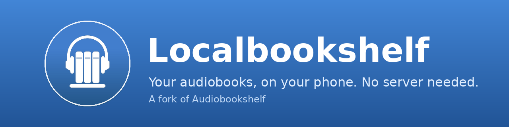

<p align="center"></p>

# Localbookshelf

Localbookshelf is an Android audiobook player that works **without a server**. Pick a folder of audiobooks on your phone and the app indexes them, looks up their metadata online, and organizes them by series and author, the way the Audiobookshelf server does, all on the device.

It is a **fork of the [Audiobookshelf mobile app](https://github.com/advplyr/audiobookshelf-app)** by advplyr. Everything the original app does still works, including connecting to an [Audiobookshelf server](https://github.com/advplyr/audiobookshelf) if you have one. The standalone local library is what this fork adds.

## How it works

1. **Add your books.** On the home screen tap **Add Local Books** (or open the side drawer, then **Local Media**) and choose the folder that holds your audiobooks. The app only reads that folder; it never moves, renames or deletes your files.
2. **Indexing.** The app walks the folder and groups files into books using the same folder-name rules as the server (for example `Author/Series/Series 1 - Title`). Each book's duration, tags and cover art are read from the audio files. A book that is just a folder of audio files is treated as one book, with one chapter per file.
3. **Metadata.** When you are online, books are matched against Audible (via Audnexus) and Google Books. Missing details such as description, narrator, series, publisher, genres and cover are filled in. Titles, authors and series that came from your folder names are never overwritten, and a book is only matched when the result is a close enough match.
4. **Organizing.** Open **Local Library** from the home screen or side drawer to browse your books grouped by **Series** (in reading order), **Authors**, or as one **All** list.
5. **Listening.** Tap a book to play it. Progress is saved on the device.

Metadata lookup needs an internet connection. Everything else works offline.

### Current limitations

- Android only. The iOS code is unchanged from upstream and has no local library.
- Chapters embedded inside a single file (such as an `.m4b`) are not read yet. Books made of one file per chapter get their chapters from the files.
- Only audiobooks are indexed from a folder, not ebooks.
- Metadata matching is automatic. There is no screen yet for picking a different match by hand.

## Building

GitHub Actions builds an APK on every push (the **Build APK** workflow). Download the `audiobookshelf-apk` artifact from a run and install it. To build locally, see the setup sections below.

## Credits and license

Localbookshelf is built on the work of the [Audiobookshelf](https://www.audiobookshelf.org) project and is released under the same GPL-3.0 license. The folder parsing and the Audible and Google Books lookups are ported from the Audiobookshelf server code. All credit for the original app and server goes to advplyr and the Audiobookshelf contributors. This fork is not affiliated with or endorsed by them.

Original project: [github.com/advplyr/audiobookshelf-app](https://github.com/advplyr/audiobookshelf-app) | server: [github.com/advplyr/audiobookshelf](https://github.com/advplyr/audiobookshelf) | [audiobookshelf.org](https://audiobookshelf.org)

## Contributing

This application is built using [NuxtJS](https://nuxtjs.org/) and [Capacitor](https://capacitorjs.com/) in order to run on both iOS and Android on the same code base.

### Localization

Thank you to [Weblate](https://hosted.weblate.org/engage/audiobookshelf/) for hosting our localization infrastructure pro-bono. If you want to see Audiobookshelf in your language, please help us localize. Additional information on helping with the translations [here](https://www.audiobookshelf.org/faq#how-do-i-help-with-translations). <a href="https://hosted.weblate.org/engage/audiobookshelf/">  </a>

### Windows Environment Setup for Android

Required Software:

- [Git](https://git-scm.com/downloads)
- [Node.js](https://nodejs.org/en/) (version 20)
- Code editor of choice([VSCode](https://code.visualstudio.com/download), etc)
- [Android Studio](https://developer.android.com/studio)
- [Android SDK](https://developer.android.com/studio)

<details>
<summary>Install the required software with <a href=(https://docs.microsoft.com/en-us/windows/package-manager/winget/#production-recommended)>winget</a></summary>

<p>
Note: This requires a PowerShell prompt with winget installed.  You should be able to copy and paste the code block to install.  If you use an elevated PowerShell prompt, UAC will not pop up during the installs.

```PowerShell
winget install -e --id Git.Git; `
winget install -e --id Microsoft.VisualStudioCode; `
winget install -e --id  Google.AndroidStudio; `
winget install -e --id OpenJS.NodeJS --version 20.11.0;
```


</p>
</details>
<br>

Your Windows environment should now be set up and ready to proceed!

### Mac Environment Setup for Android

Required Software:

- [Android Studio](https://developer.android.com/studio)
- [Node.js](https://nodejs.org/en/) (version 20)
- [Cocoapods](https://guides.cocoapods.org/using/getting-started.html#installation)
- [Android SDK](https://developer.android.com/studio)

<details>
<summary>Install the required software with <a href=(https://brew.sh/)>homebrew</a></summary>

<p>

```zsh
brew install android-studio node cocoapods
```

</p>
</details>

### Start working on the Android app

Clone or fork the project from terminal or powershell and `cd` into the project directory.

Install the required node packages:

```shell
npm install
```

<details>
<summary>Expand for screenshot</summary>


</details>
<br>

Generate static web app:

```shell
npm run generate
```

<details>
<summary>Expand for screenshot</summary>


</details>
<br>

Copy web app into native android/ios folders:

```shell
npx cap sync
```

<details>
<summary>Expand for screenshot</summary>


</details>
<br>

Open Android Studio:

```shell
npx cap open android
```

<details>
<summary>Expand for screenshot</summary>


</details>
<br>

Start coding!

After making changes to the JS layer you need to rebuild the nuxt pages and sync them to the native shells:

```shell
npm run sync
```

### Mac Environment Setup for iOS

Required Software:

- [Xcode](https://developer.apple.com/xcode/)
- [Node.js](https://nodejs.org/en/)
- [Cocoapods](https://guides.cocoapods.org/using/getting-started.html#installation)

### Start working on the iOS app

Clone or fork the project in the terminal and `cd` into the project directory.

Install the required node packages:

```shell
npm install
```

<details>
<summary>Expand for screenshot</summary>


</details>
<br>

Generate static web app:

```shell
npm run generate
```

<details>
<summary>Expand for screenshot</summary>


</details>
<br>

Copy web app into native android/ios folders:

```shell
npx cap sync
```

<details>
<summary>Expand for screenshot</summary>


</details>
<br>

Open Xcode:

```shell
npx cap open ios
```

<details>
<summary>Expand for screenshot</summary>


</details>
<br>

Start coding!

After making changes to the JS layer you need to rebuild the nuxt pages and sync them to the native shells:

```shell
npm run sync
```
